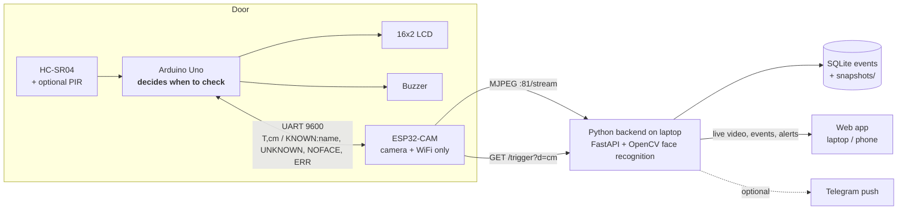
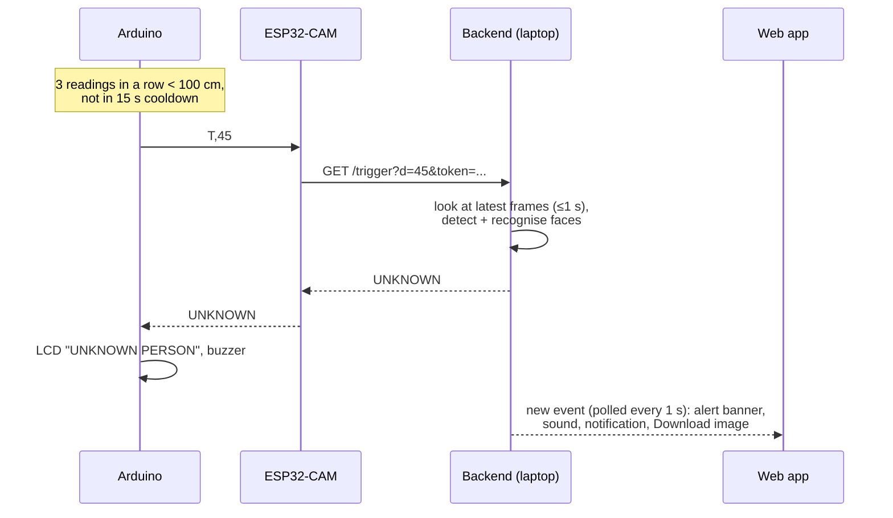

# Smart Door Monitoring System

An Arduino watches the door with an ultrasonic sensor. When someone stands in front of it, it asks
"who is this?". An ESP32-CAM streams video to a laptop, where Python recognises the face. The answer
comes back to the Arduino (LCD + buzzer), and the owner sees everything live in a web app
(alerts for unknown visitors, snapshot download, history).



**One door check, step by step**



## Hardware

| Part | Notes |
|---|---|
| Arduino Uno (Nano/Mega also fine) | the "brain" |
| ESP32-CAM AI Thinker (OV2640) + MB board or FTDI | camera + WiFi only |
| HC-SR04 ultrasonic sensor | distance |
| PIR sensor (optional) | extra wake-up condition |
| 16x2 LCD with I2C backpack (0x27) | status |
| Buzzer (active) | alarm |
| 1 kΩ + 2 kΩ resistors | 5 V → 3.3 V divider on Arduino TX → ESP32 RX |
| 5 V ≥1 A supply for the ESP32-CAM | prevents brownout resets |
| Laptop (Windows or macOS) on the same WiFi | runs the backend |

**Wiring and flashing: [docs/wiring.md](docs/wiring.md)**. Demo walkthrough and viva questions: [docs/demo_script.md](docs/demo_script.md).

## Project layout

```
backend/            FastAPI app (python -m backend)
  config.py         settings from .env / environment variables
  camera.py         MJPEG / webcam reader thread with auto-reconnect
  recognizer.py     Recognizer interface: dlib (face_recognition) or OpenCV YuNet+SFace
  core.py           door-check logic (verdict, cooldown, snapshots, alerts) + annotated live feed
  events.py         SQLite event history, snapshot clean-up
  alerts.py         optional Telegram push
  app.py            HTTP endpoints + token auth
web/index.html      single-page web app (no external dependencies)
firmware/arduino/door_arduino/door_arduino.ino
firmware/esp32_cam/esp32_cam/esp32_cam.ino   (+ secrets.h.example)
tools/fake_esp32.py     fake camera + relay (test without boards)
tools/fake_arduino.py   sends T,<cm> like the Arduino
enroll.py           capture photos of a known person
tests/              pytest
faces/<name>/*.jpg  enrolled photos (git-ignored)
snapshots/          event snapshots (git-ignored, auto-deleted after 7 days)
data/events.db      event history (git-ignored)
models/             OpenCV face models (auto-downloaded on first run, ~40 MB)
```

## Setup

Requires Python 3.10+ (tested with 3.14 on Windows 11).

**Windows (PowerShell)**
```powershell
py -m venv .venv
.venv\Scripts\activate
pip install -r requirements.txt
copy .env.example .env      # then edit .env: API_TOKEN, STREAM_URL
```

**macOS (Terminal)**
```bash
python3 -m venv .venv
source .venv/bin/activate
pip install -r requirements.txt
cp .env.example .env        # then edit .env: API_TOKEN, STREAM_URL
```

Check that face recognition works (downloads the models the first time):
```
python -m backend --check
```

### Face recognition backend
`FACE_BACKEND=auto` (the default) uses `face_recognition`/dlib **if it is installed**, otherwise it falls back
to **OpenCV YuNet + SFace**, which needs nothing beyond `opencv-python` and is fast on any laptop CPU
(~15 ms per frame measured). dlib needs CMake + a C++ compiler and often fails to build, especially on Windows
and on new Python versions. That's why it's optional: `pip install -r requirements-dlib.txt` if you want it.
Both backends sit behind the same small `Recognizer` interface, so nothing else changes.

## Run

```bash
python -m backend                 # backend + web app on http://localhost:8000
```
Open **http://localhost:8000/?token=YOUR_API_TOKEN** (the token is remembered by the browser), and click
**🔔 Enable alerts** once (browsers only allow sound/notifications after a click).
From your phone: `http://<laptop-ip>:8000/?token=...`.

### Without any hardware
```bash
python tools/fake_esp32.py                        # terminal 1: laptop webcam as the "ESP32-CAM"
python -m backend                                 # terminal 2 (STREAM_URL=http://127.0.0.1:8081/stream)
python tools/fake_arduino.py 45                   # terminal 3: "someone at 45 cm" -> prints verdict + LCD text
```
`fake_esp32.py --source video.mp4 | photos_folder/ | pattern` uses a video, images (switch with
`http://127.0.0.1:8081/next`) or a test pattern instead of the webcam.

**Real Arduino, no ESP32:** set `#define ESP_LINK_USB 1` in the sketch, upload, then
`python tools/fake_esp32.py --serial COM5` (macOS: `/dev/tty.usbmodem...`). Close the Arduino Serial Monitor first.
**Real ESP32, no Arduino:** connect the ESP32-CAM's U0R/U0T to a USB-serial adapter and
`python tools/fake_arduino.py --serial COM6 45`.

### Flashing from the command line (optional, instead of the Arduino IDE)
```bash
python tools/flash.py ports                      # which COM port is which board
python tools/flash.py arduino --port COM5        # Uno
python tools/flash.py esp32 --port COM6          # ESP32-CAM (IO0 to GND + RST first)
python tools/flash.py monitor --port COM6        # see "IP:..." from the ESP32 at 9600 baud
```
Uses arduino-cli (already set up in `C:\Users\sanja\arduino-cli` on the dev laptop, with the AVR + ESP32 cores
and the LiquidCrystal I2C library).

Windows firewall: right-click `tools\open_firewall.bat` → *Run as administrator* (opens TCP 8000).

### Enrol known people
Either the web app → **Faces** tab (upload photos, or "Capture from door camera" a few times), or:
```bash
python enroll.py Alice              # 10 photos from the door camera (via the running backend)
python enroll.py Alice --webcam     # from the laptop webcam
```
Use 5–10 photos per person, good light, slightly different angles. Faces reload without a restart.

### Tests
```bash
python -m pytest
```

## Configuration (.env)

| Variable | Default | Meaning |
|---|---|---|
| `STREAM_URL` | `http://127.0.0.1:8081/stream` | ESP32: `http://<ip>:81/stream`; webcam: `0` |
| `PORT` / `HOST` | `8000` / `0.0.0.0` | web server |
| `API_TOKEN` | *(empty = no auth, warning)* | shared secret; also in ESP32 `secrets.h` |
| `FACE_BACKEND` | `auto` | `auto`, `dlib`, `opencv` |
| `FACE_TOLERANCE` | backend default (dlib 0.6, opencv 0.60) | lower = stricter |
| `PROCESS_WIDTH` | `480` | frames are downscaled to this before recognition |
| `RECOGNIZE_EVERY_N` | `3` | live feed recognises every Nth frame |
| `CHECK_WINDOW_S` | `1.0` | max time per door check |
| `COOLDOWN_S` | `15` | same verdict logged/alerted at most once per window |
| `SNAPSHOT_MAX_AGE_DAYS` | `7` | older snapshots are deleted |
| `ALERT_WEBHOOK` | *(off)* | `telegram` to enable push alerts |
| `TELEGRAM_BOT_TOKEN`, `TELEGRAM_CHAT_ID` | | see below |

### Telegram alerts (optional)
1. In Telegram, message **@BotFather** → `/newbot` → copy the bot token.
2. Send any message to your new bot.
3. Open `https://api.telegram.org/bot<TOKEN>/getUpdates` in a browser, find `"chat":{"id":123456789` → that's the chat id.
4. In `.env`: `ALERT_WEBHOOK=telegram`, `TELEGRAM_BOT_TOKEN=...`, `TELEGRAM_CHAT_ID=...`, restart. Unknown visitors now arrive as a photo message.

## HTTP API

All endpoints except `/` and `/health` need the token, as header `X-Token: ...` or query `?token=...`.

| Endpoint | Purpose |
|---|---|
| `GET /` | web app |
| `GET /health` | `{camera_online, face_backend, known_people, ...}` |
| `GET /video` | annotated MJPEG (boxes + names + timestamp) |
| `GET /trigger?d=<cm>` | run a door check → plain text `KNOWN:<name>` / `UNKNOWN` / `NOFACE` / `ERR` |
| `GET /events?after=<id>` | events newer than id (0 = latest 50) |
| `GET /snapshots/<file>[?download=1]` | snapshot image / download |
| `GET /frame.jpg` | latest raw frame (used by enroll.py) |
| `GET /api/faces`, `POST /api/faces/<name>` (upload), `POST /api/faces/<name>/capture`, `DELETE /api/faces/<name>`, `POST /api/faces/reload` | face management |

**Serial protocol (9600 baud, `\n`-terminated)**: Arduino → ESP32 `T,<distance_cm>`; ESP32 → Arduino
`KNOWN:<name>` | `UNKNOWN` | `NOFACE` | `ERR`. Extra: ESP32 sends `IP:<address>` once after joining WiFi
(the Arduino shows it on the LCD; any other line is ignored).

## Troubleshooting

| Symptom | Cause / fix |
|---|---|
| ESP32-CAM keeps rebooting, LED restarts, "Brownout detector was triggered" | Power. Use a 5 V ≥1 A supply on the 5V pin, short wires, common GND. Not the 3.3 V pin. |
| Arduino LCD always "No server reply" | ESP32 gets no answer: check `BACKEND_URL` IP/port in `secrets.h`, `API_TOKEN` matches `.env`, laptop firewall (below), both on the same WiFi. Open `http://<laptop-ip>:8000/health` from your phone to test. |
| Arduino never gets any reply, ESP32 works in a browser | Serial wiring: ESP U0T→D10, D11→divider→U0R, **common GND**. MB board removed? Baud 9600 both sides? |
| Garbage / ESP32 damaged risk | Never connect Arduino D11 straight to U0R: use the 1k/2k divider. |
| Upload to ESP32 fails | IO0 to GND + RST for flash mode; disconnect Arduino from U0R/U0T while flashing. See docs/wiring.md. |
| ESP32 never connects to WiFi (fast blinking forever) | 2.4 GHz only; check SSID/password; campus/"guest" WiFi often blocks devices talking to each other → use a **phone hotspot** (iPhone: turn on "Maximize Compatibility"). |
| Web app shows "camera offline" | `STREAM_URL` wrong, or another client (a browser tab) is holding the ESP32 stream: the ESP32 serves one stream at a time well. Close other viewers; use the web app's feed instead. |
| Phone can't open the web app | **Firewall.** Windows: allow Python on *Private* networks when prompted, or run (admin) `netsh advfirewall firewall add rule name="Door monitor 8000" dir=in action=allow protocol=TCP localport=8000`; make sure the WiFi profile is *Private*. macOS: System Settings → Network → Firewall → Options → allow Python. |
| No browser notification on the phone | Browsers only allow notifications on `https` or `localhost`; over plain LAN http the red banner + sound still work. On the laptop use `http://localhost:8000`. |
| High CPU on the laptop | Increase `RECOGNIZE_EVERY_N` (e.g. 5), lower `PROCESS_WIDTH` (e.g. 360), or set the ESP32 to `FRAMESIZE_QVGA`. Close extra `/video` viewers (each one re-sends frames). |
| Known person shown as UNKNOWN | Add more photos in door lighting (use "Capture from door camera"); raise `FACE_TOLERANCE` slightly (opencv: 0.65). Strangers matched as known → lower it. |
| `python -m backend --check` fails to download models | No internet: copy the two `.onnx` files into `models/` manually (URLs in `backend/recognizer.py`). |

## Design decisions & defaults

* **Arduino decides, laptop recognises.** Timing, debounce and cooldown are on the Arduino; face recognition
  needs far more compute than an Uno or ESP32 has, so it runs on the laptop. The ESP32 only moves bytes.
* **Two cooldowns.** Arduino: no new check for 15 s after one. Backend: the same verdict is not logged/alerted
  twice within `COOLDOWN_S`, even if several triggers arrive (the Arduino still gets its answer).
* **Fast verdicts.** A known face returns immediately; UNKNOWN needs 3 frames in a row with only strangers
  (~0.1–0.3 s); NOFACE waits the full `CHECK_WINDOW_S` (1 s) in case the person is still turning.
* **Snapshots** are saved for known and unknown visitors (thumbnails in the log); only unknown ones raise alerts.
* **Auth** is a shared token (header or query param) because the ESP32 and an `` video tag can't easily do more.
  It is not encryption; keep it on your home network.
* The original draft files (app.py, index.html, door_arduino.ino, esp32_relay_snippet.cpp) were not present
  in the working folder, so everything was written from scratch to the spec.

## Limitations / future work
* 2D face recognition can be fooled by a printed photo (no liveness detection).
* Low light / backlight at the door hurts accuracy: add IR illumination or use the ESP32 flash LED.
* Plain HTTP on the LAN; HTTPS + proper user accounts for anything beyond a demo.
* ESP32 → backend over WiFi only; offline fallback (e.g. SD-card snapshots) not implemented.
