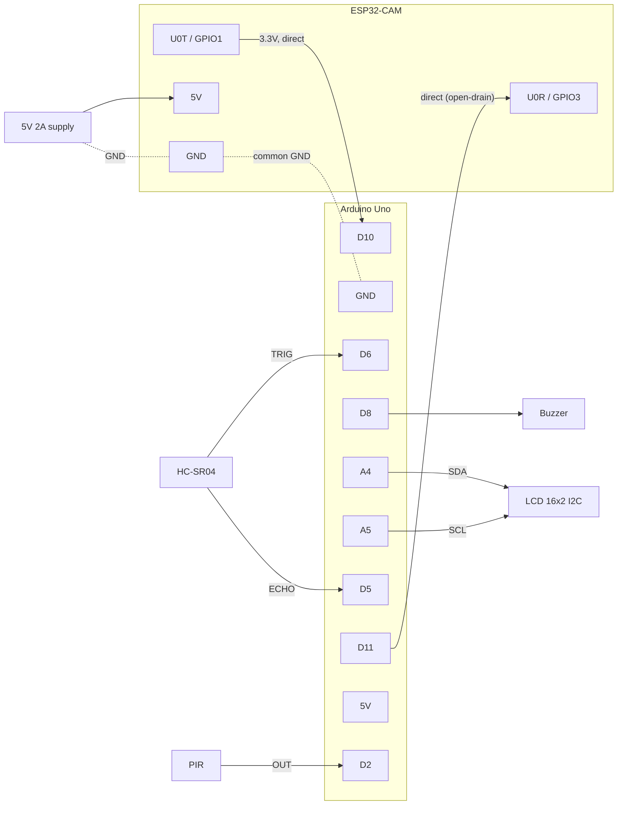

# Wiring & flashing

## 1. Wiring table

| From | Pin | To | Notes |
|---|---|---|---|
| **HC-SR04** | VCC | Arduino 5V | |
| | GND | Arduino GND | |
| | TRIG | Arduino **D6** | TRIG/ECHO may be swapped: the sketch detects it at start-up |
| | ECHO | Arduino **D5** | 5 V output, fine for the Uno |
| **PIR** (optional) | VCC | Arduino 5V | needs ~30–60 s to settle after power-up |
| | GND | Arduino GND | |
| | OUT | Arduino **D2** | set `PIR_MODE` in the sketch to use it |
| **Buzzer** | + (long leg) | Arduino **D8** | active buzzer assumed; passive → `BUZZER_IS_PASSIVE = true` |
| | − | Arduino GND | |
| **LCD 16x2 I2C** | VCC | Arduino 5V | backpack address usually 0x27 (else 0x3F) |
| | GND | Arduino GND | |
| | SDA | Arduino **A4** | |
| | SCL | Arduino **A5** | |
| **ESP32-CAM** | 5V | **5 V supply, ≥1 A** | see "Power" below |
| | GND | supply GND **and** Arduino GND | **common ground is mandatory** |
| | U0T (GPIO1) | Arduino **D10** (SoftwareSerial RX) | direct wire (3.3 V is read as HIGH) |
| | U0R (GPIO3) | Arduino **D11** | **direct wire** with the default open-drain mode (no resistors); divider only if `ESP_TX_OPEN_DRAIN = false` |

### Level shifting (Arduino TX → ESP32 RX)

**Default: no resistors needed.** The sketch uses *open-drain* signalling on D11: for a 0 bit it pulls the
line to GND, for a 1 bit it releases the pin (high impedance) and the ESP32's internal pull-up
(enabled in the ESP32 firmware) lifts the line to 3.3 V. The Arduino never drives 5 V onto the ESP32.

**Alternative (classic):** set `ESP_TX_OPEN_DRAIN = false` and use a resistor divider:

The Uno outputs 5 V, but ESP32 pins are 3.3 V only. Put a voltage divider on that one line:

```
Arduino D11 ──[ 1 kΩ ]──┬──────────► ESP32-CAM U0R (GPIO3)
                        │
                     [ 2 kΩ ]        Vout = 5 V × 2k / (1k + 2k) = 3.33 V
                        │
Arduino GND ────────────┴──────────── ESP32-CAM GND
```

No 2 kΩ? Use two 1 kΩ in series. 10 kΩ + 20 kΩ also works at 9600 baud.
The other direction (ESP32 TX → Arduino RX) needs nothing: the Uno reads ≥3.0 V as HIGH, and 3.3 V is just above that.
If that line is unreliable, use a bidirectional level-shifter module (BSS138) instead.

### Power

The ESP32-CAM draws 300–400 mA spikes when WiFi transmits. Powered from a weak source it **resets in a loop (brownout)**.

* Best: a separate 5 V / 2 A supply (a USB phone charger + breakout) to ESP32-CAM 5V/GND, **and connect its GND to the Arduino GND**.
* OK for a quick test: Arduino 5V pin when the Uno is on a good USB port. Keep the 5V/GND wires short and thick.
* Do **not** power the ESP32-CAM from its 3.3 V pin.

### Diagram



ASCII version:

```
                 +-----------------------+
   HC-SR04 TRIG--| D6                 5V |--+-- HC-SR04 VCC, PIR VCC, LCD VCC
   HC-SR04 ECHO--| D5                GND |--+-- all GNDs (incl. ESP32-CAM GND!)
       PIR OUT --| D2                 A4 |---- LCD SDA
    Buzzer (+) --| D8                 A5 |---- LCD SCL
                 |                       |
  ESP U0T(IO1) --| D10 (RX)              |
  ESP U0R(IO3) <-| D11 (TX, open-drain)  |
                 +----- Arduino Uno -----+

   5V 2A supply ---- ESP32-CAM 5V      supply GND ---- ESP32-CAM GND ---- Arduino GND
```

### Other boards
* **Arduino Mega**: works as is (SoftwareSerial RX on D10 is supported). Or use `Serial1` (pins 18/19) by replacing `espSerial`.
* **Nano**: identical pins to the Uno.
* **3.3 V boards** (e.g. Arduino Due/Zero, ESP8266): no divider needed, but check the HC-SR04 ECHO (5 V) needs a divider instead.

---

## 2. Flashing the Arduino

1. Arduino IDE → *Tools → Board → Arduino Uno*, select the COM/tty port.
2. *Sketch → Include Library → Manage Libraries* → install **"LiquidCrystal I2C" by Frank de Brabander**.
3. Open `firmware/arduino/door_arduino/door_arduino.ino`, check the pin/settings block at the top, Upload.
4. *Tools → Serial Monitor* at **115200** shows debug lines (`-> T,45`, `<- KNOWN:Alice`).

LCD blank? Turn the blue contrast pot on the I2C backpack. Still nothing → try `LCD_ADDR = 0x3F`, or run *File → Examples → Wire → i2c_scanner*.

Uploading works with the ESP32 connected (it uses pins 10/11, not 0/1).

---

## 3. Flashing the ESP32-CAM

### One-time Arduino IDE setup
1. *File → Preferences → Additional boards manager URLs*: `https://espressif.github.io/arduino-esp32/package_esp32_index.json`
2. *Tools → Board → Boards Manager* → install **esp32 by Espressif Systems**.
3. Copy `firmware/esp32_cam/esp32_cam/secrets.h.example` → `secrets.h` (same folder) and fill in WiFi (2.4 GHz!), `BACKEND_URL` (laptop IP, port 8000) and `API_TOKEN` (same as `.env`).

### Board settings (Tools menu)
| Setting | Value |
|---|---|
| Board | **AI Thinker ESP32-CAM** |
| Partition Scheme | Huge APP (3MB No OTA/1MB SPIFFS) (default for this board) |
| Flash Mode | **DIO** (QIO makes many clones reboot every second) |
| Flash Frequency | **40MHz** |
| Upload Speed | 115200 (try 460800 if it works reliably) |
| Core Debug Level | **None** (important: UART0 is the Arduino link) |
| PSRAM | Enabled (fixed on this board) |

### Option A – ESP32-CAM-MB base board (USB)
1. **Disconnect the Arduino wires** from U0R/U0T. Plug the ESP32-CAM onto the MB board, USB to laptop.
2. Select the port (CH340 driver may be needed on Windows/macOS).
3. Click Upload. When the IDE shows `Connecting.....`: **hold IO0**, press and release **RST**, release IO0 (many MB boards do this automatically).
4. After "Hard resetting via RTS pin", press **RST** to run the new firmware.
5. Open Serial Monitor at **9600**, press RST: after a few seconds you should see `IP:192.168.x.x`.
6. **Remove the MB board** before wiring to the Arduino: the MB's USB chip is also connected to U0R/U0T and would fight the Arduino. Power the ESP32-CAM through its 5V/GND pins instead.

### Option B – FTDI / USB-serial adapter
| FTDI | ESP32-CAM |
|---|---|
| GND | GND |
| 5V (VCC jumper on 5V) | 5V |
| TX | U0R (GPIO3) |
| RX | U0T (GPIO1) |
| — | **IO0 → GND** (jumper wire) = flash mode |

1. Put the IO0–GND jumper in, press **RST**, click Upload.
2. When done: **remove the IO0–GND jumper**, press **RST**.
3. Serial Monitor at 9600 shows `IP:...`.

### Check it works
* Red LED: fast blink while connecting, 3 long blinks when connected.
* Browser: `http://<esp32-ip>/` (status) and `http://<esp32-ip>:81/stream` (video). Close the stream tab afterwards: the backend should be the only stream client.
* Put `STREAM_URL=http://<esp32-ip>:81/stream` in `.env` and restart the backend.

### Common flashing errors
| Error | Fix |
|---|---|
| `Failed to connect to ESP32: No serial data received` / `Timed out waiting for packet header` | Not in flash mode: IO0 must be at GND while pressing RST. Check TX↔RX are crossed. |
| Reboots about once per second right after `entry 0x400805b4`, `rst:0x3 (SW_RESET)` | Flash Mode QIO / 80 MHz not supported by the clone: use **DIO** and **40MHz**, re-upload. |
| `Brownout detector was triggered` (in Serial Monitor at 115200) | Power problem: better 5 V supply, shorter wires. |
| `Camera init failed` / LED rapid double blink | Ribbon cable not seated: lift the black latch, reseat the camera, close the latch. |
| Upload works, but nothing happens | You left IO0 on GND. Remove it, press RST. |
| Port not visible | Install CH340 (MB board) or FTDI driver; try another USB cable (some are charge-only). |
